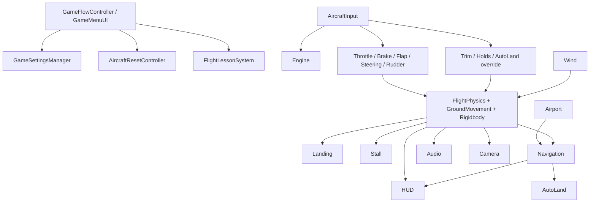

# Simply Fly — Project Script Reference

> Scope: every project-owned C# file under `Assets/SimplyFly`, including editor tools/tests. Unity/TMP sample scripts and third-party scripts are excluded. Component locations describe `Main.unity` when confirmed; otherwise they state runtime/editor usage. Method lists emphasize lifecycle and public/architecturally significant methods rather than trivial private drawing helpers.

## Runtime scripts (`Assets/SimplyFly/Scripts`)

| Script/class | Purpose and placement | Important API, update use and dependencies | Risks / unusual details |
|---|---|---|---|
| `AircraftAudioController.cs` — `AircraftAudioController` | Aircraft layered audio; on `Aircraft`. | `Awake`, `Update`, landing-event handlers, volume setters. Reads engine, throttle, physics, ground, brakes, stall, landing, flaps and rudder; creates/configures AudioSources. | 653 lines; missing mixer and several clips in Main; multiple layers share one clip. |
| `AircraftInput.cs` — `AircraftInput` | Central keyboard/mouse/test/automation input on `Aircraft`. | `Update`, `SetTestControls`, `ClearTestControls`, `SetAutomationControls`, `ClearAutomationControls`. Called by tests and AutoLand; read by all controllers. | Direct device polling; test override outranks automation; not driven by Input Actions asset. |
| `AircraftRelativeWind.cs` — `AircraftRelativeWind` | Small shared helper/value source for relative airflow. | Computes velocity relative to wind/aircraft. | Verify consumer before extending; functionality overlaps physics air-data calculation. |
| `AircraftResetController.cs` — `AircraftResetController` | Repositions aircraft and resets all controller state. | Reset/spawn methods; zeroes Rigidbody and invokes controller reset APIs. | Depends on complete component set; missed reset members can leak prior-flight state. |
| `AircraftSpeedPerformance.cs` — `AircraftSpeedPerformance` | Central named speed-performance constants/data. | Exposes performance values used by guidance/assists. | Simplified fixed speeds, not atmosphere/weight dependent. |
| `AirportLocationManager.cs` — `AirportLocationManager`, plus serializable airport/runway records | Owns airport data, active runway, spawn/threshold geometry; on world manager object. | Selection, reciprocal-runway helpers, spawn/threshold access, airport-changed event. Called by flow, navigation, weather, UI and reset. | Airport database is scene-serialized rather than a ScriptableObject database. |
| `AirportReferenceToggle.cs` — `AirportReferenceToggle` | Debug/reference visibility toggle. | `Update` key handling and visibility application. | Development-facing scene dependency. |
| `AirportSelectorUI.cs` — `AirportSelectorUI` | Simple airport-selection UI. | UI callbacks populate/select/reset. Calls airport manager/reset. | Overlaps newer `GameMenuUI` planner functionality. |
| `AirspeedTapeHUD.cs` — `AirspeedTapeHUD` | Airspeed tape rendering. | `Update`/refresh; reads physics and trend predictor. | Presentation smoothing can lag raw diagnostic value. |
| `AirspeedTrendPredictor.cs` — `AirspeedTrendPredictor` | Filters acceleration and predicts short-term airspeed trend. | Frame update and predicted-speed properties. | Frame-rate/smoothing dependent presentation aid. |
| `AltitudeTapeHUD.cs` — `AltitudeTapeHUD` | Altitude tape specialization. | Inherits/configures `NumericTapeHUD`; reads aircraft altitude. | World-Y versus AGL context must be kept explicit. |
| `ApproachGuidanceController.cs` — `ApproachGuidanceController` | Measures runway-relative distance, height, alignment and glide error; on `Aircraft`. | `Awake`, `FixedUpdate`, runway assignment. Reads physics/Rigidbody and threshold transform. | Main points to a fixed threshold; navigation has richer selected-runway guidance. |
| `ApproachGuidanceDisplayMode.cs` — enum | Defines approach helper display modes. | Consumed by settings/HUD/visualizer. | Data-only. |
| `ApproachGuidanceHUD.cs` — `ApproachGuidanceHUD` | Approach deviation symbology. | `Update`/draw/visibility APIs; reads navigation/approach/settings. | Main typed reference is null; fallback discovery is relied upon. |
| `ApproachTrajectoryVisualizer.cs` — `ApproachTrajectoryVisualizer` | Draws predicted trajectory, glide corridor and touchdown marker. | Builds/updates LineRenderers and labels per frame; settings setters. | 476-line runtime-generated visualization; allocation/material lifecycle needs care. |
| `AssistedTrimController.cs` — `AssistedTrimController` | Capturable assisted elevator trim on `Aircraft`. | `Update`, capture/reset, enable/strength setters; read by flight physics. | Disabled in Main; recommendations and actual trim are separate states. |
| `AutoLandController.cs` — `AutoLandController` | Optional full approach/flare/rollout automation. | `Awake`, `Update`, `Disengage`, phase and availability logic; overrides `AircraftInput`. | Not confirmed in Main; automation operates in `Update` while forces apply in physics ticks. |
| `AutoLandStatusHUD.cs` — `AutoLandStatusHUD` | Displays AutoLand availability/phase. | `Update`; reads AutoLand. | Main reference null and controller absent. |
| `BrakeController.cs` — `BrakeController` | Held and parking brake state/force. | `Update`, `SetParkingBrake`, reset; read by ground and HUD/audio. | Parking toggle is edge-triggered in input. |
| `BrakeStatusHUD.cs` — `BrakeStatusHUD` | Brake/parking status display. | `Update`; reads brakes. | Main typed HUD reference null. |
| `CameraController.cs` — `CameraController` | Multi-mode chase/cockpit/wing/cinematic camera, collision, recenter and motion. | `Awake/Start/Update/LateUpdate`, mode selection/cycling, reset, settings application. Reads input, flow, Rigidbody/aircraft state. | 1,546 lines; fallback anchors and auto-discovery hide wiring omissions; many coupled presentation tunings. |
| `EngineAudioController.cs` — `EngineAudioController` | Older/simple engine audio controller. | `Update`; reads engine/throttle and drives one source. | Likely superseded by `AircraftAudioController`; duplicate responsibility. |
| `EngineController.cs` — `EngineController` | Engine running/start-stop state. | `Update`, start/stop/toggle/reset; reads `AircraftInput`. | Binary engine model; no spool/mixture/fuel/temperature simulation. |
| `EngineInstrumentController.cs` — `EngineInstrumentController` | Bridges engine/throttle data to engine instrument. | `Update`; reads engine/throttle. | Overlaps `EngineInstrumentHUD`. |
| `EngineInstrumentHUD.cs` — `EngineInstrumentHUD` | Power/RPM visual presentation. | `Update` and drawing helpers; reads engine/throttle/propeller. | RPM is presentation/tuned, not a thrust-producing prop simulation. |
| `ExperimentalFeatureFlags.cs` — `ExperimentalFeatureFlags` | Compile/runtime constants for experimental systems. | Static flags only. | Easy for code and scene settings to disagree. |
| `FlapController.cs` — `FlapController` | Flap stages, transit and aerodynamic multipliers. | `Update`, extend/retract/set/reset; exposes lift/drag/control effects. | Discrete scripted stages; no surface-force location. |
| `FlapsInstrumentHUD.cs` — `FlapsInstrumentHUD` | Flap stage/transit HUD. | `Update`; reads flaps. | Typed Main reference null. |
| `FlightHoldAssistController.cs` — `FlightHoldAssistController` | Pitch Hold and VS Hold PI-like elevator assists. | `Update`, mode toggles/capture/reset/settings, correction property. Reads input/physics/stall. | Main permits VS Hold on ground and at low speed; integral and manual-disengage interactions need testing. |
| `FlightHUDController.cs` — `FlightHUDController` | Central Canvas HUD coordinator and warnings. | `Awake/Start/Update`, visibility/settings, landing feedback handlers. Reads most flight systems. | 562 lines; mixture of old generic instruments and newer typed HUD components with null fallbacks. |
| `FlightHUDInstrument.cs` — `FlightHUDInstrument` | Generic label/value/bar instrument adapter. | Set value/text/color/visibility methods. | Legacy generic layer; unit semantics live in callers. |
| `FlightHUDStyle.cs` — `FlightHUDStyle` | Shared HUD colors/fonts/format helpers. | Static style/format members. | Code-defined styling rather than a theme asset. |
| `FlightLessonSystem.cs` — `FlightLessonSystem` and lesson data | Runs flight-school lesson state/checks. | Start/stop/update lesson, progression/events; reads aircraft systems. | 900 lines and tightly coupled to concrete flight diagnostics. |
| `FlightPathMarkerHUD.cs` — `FlightPathMarkerHUD` | Projects velocity vector onto HUD. | `LateUpdate`/visibility; reads Rigidbody/camera/physics. | Invalid at very low forward speed; camera projection dependent. |
| `FlightPhysicsController.cs` — `FlightPhysicsController` | Primary aerodynamic/state/control force model on `Aircraft`. | `Awake`, `FixedUpdate`, reset/spawn/landing transition methods; exposes all air data. Calls Rigidbody, wind, engine/throttle, ground, stall, flaps, trim, hold. | 1,092 lines; empirical capped model, several responsibilities, peer FixedUpdate order not explicit. |
| `FlightSchoolUI.cs` — `FlightSchoolUI` | Flight-school lesson panel. | UI Toolkit setup/update and lesson event handlers. | Runtime-built UI; depends on exact element/event lifecycle. |
| `FlightTelemetryRecorder.cs` — `FlightTelemetryRecorder` | Captures periodic flight samples and summaries. | Start/stop/reset/record in update/fixed cadence; export access. | Large sample surface can drift from renamed diagnostics. |
| `FlightTelemetrySample.cs` — sample DTO | Serializable telemetry record. | Capture/CSV/serialization helpers. | Schema compatibility is manual. |
| `FlightTestDebugUI.cs` — `FlightTestDebugUI` | Development test controls/status. | OnGUI/Update and runner callbacks. | IMGUI development surface; not production UI. |
| `FlightTestExporter.cs` — `FlightTestExporter` | Writes test output. | Export methods called by runner/debug UI. | External file I/O path and culture formatting require CI care. |
| `FlightTestRunner.cs` — `FlightTestRunner` | Automated scenario execution using input overrides. | Scenario coroutines/state machine, start/cancel/update, telemetry/export. | 883 lines; takes highest-priority test control override and can mask player/AutoLand. |
| `FlightTestScenario.cs` — scenario DTO | Defines test phases/targets. | Serializable data read by runner. | Not a ScriptableObject asset in current implementation. |
| `FlightTestSummary.cs` — summary DTO | Aggregated pass/fail metrics. | Data/formatting helpers. | Threshold meaning belongs to runner. |
| `FlightTrimHUDView.cs` — `FlightTrimHUDView` | Trim position/recommendation display. | `Update`; reads trim. | Can display recommendation while trim disabled. |
| `GameFlowController.cs` — `GameFlowController` | Single-scene menu/free-flight/school/pause state machine. | Mode start, pause/resume, return menu; coordinates reset, lessons, HUD, settings/camera. | Camera reference null in Main and found at runtime; uses time scale for pause. |
| `GameMenuUI.cs` — `GameMenuUI` | Main menu, planner and settings UI Toolkit application. | `Awake/Start/Update`, extensive UI construction/callbacks. Calls flow, airport, lessons, settings, navigation. | 1,691 lines; monolithic and UI tree is code-generated; several references null in Main. |
| `GameSettingsManager.cs` — `GameSettingsManager`, `CameraSettingsData` | PlayerPrefs persistence and application for all user settings. | `Awake`, setters, load/save/default/apply. Calls audio, HUD, awareness, camera, trim, hold, nav, weather, mouse yoke. | 683 lines; unversioned string keys; scene searches can silently leave settings unapplied. |
| `GroundMovementController.cs` — `GroundMovementController` | Custom grounded thrust, resistance, grip, speed limiting and ground detection. | `Awake`, `FixedUpdate`, transition/reset/diagnostics. Reads engine/throttle/brakes/wheels; writes Rigidbody. | Reconfigures WheelColliders; separate thrust model from flight physics. |
| `HeadingRibbonController.cs` — `HeadingRibbonController` | Bridges heading source to ribbon. | `Update`; reads flight physics. | Overlaps direct-reading ribbon HUD. |
| `HeadingRibbonHUD.cs` — `HeadingRibbonHUD` | Heading ribbon/bug/navigation markers. | `Update`, rebuild/position labels; reads physics/navigation. | Runtime label pool and wraparound logic. |
| `LandingController.cs` — `LandingController` | Runway-height/contact/touchdown grading and landing transition. | `Awake`, `FixedUpdate`, reset; landing events and grade properties. Calls flight physics lift/landing-roll methods. | Terrain/runway assumptions and ray masks affect touchdown; 381-line mixed detector/evaluator. |
| `MiniAttitudeController.cs` — `MiniAttitudeController` | Simple attitude bridge. | `Update`; reads aircraft transform. | Likely superseded by `MiniAttitudeHUD`. |
| `MiniAttitudeHUD.cs` — `MiniAttitudeHUD` | Artificial horizon/bank/pitch presentation. | `Update`, graphic transforms. | Screen geometry is code-tuned. |
| `MouseYokeController.cs` — `MouseYokeController` | Mouse position/delta to elevator/aileron. | `Update`, enable/configure/reset; read by AircraftInput. | No Main instance confirmed; settings reference null, so feature depends on runtime addition/discovery. |
| `NavigationManager.cs` — `NavigationManager` and waypoint/phase records | Route generation, terrain/approach validation and live lateral/vertical guidance. | Route planning/clear/start/cancel/update, safe-altitude calculation, runway selection, geometry helpers. Calls airport manager and reads physics/landing. | 1,088 lines; physics raycasts and scene layers affect route validity; many hard-coded gains/tolerances. |
| `NavigationUI.cs` — `NavigationUI` | Planner/map/route/vertical-profile UI Toolkit view. | UI construction, `Update`, map/profile drawing, settings methods. Reads navigation/airports/physics. | 1,138 lines; runtime-generated UI and map scaling; reference in settings is assigned but GameMenu field is null. |
| `NumericTapeHUD.cs` — `NumericTapeHUD` | Reusable scrolling numeric tape base. | `Awake/Update`, value source/format/layout hooks. | 485-line presentation base; derived source and units must match. |
| `PilotAwarenessAssist.cs` — `PilotAwarenessAssist` | HUD/audio/motion cues for bank, sink, low energy, alignment and touchdown. | `Update`, settings, cue properties/events. Reads most aircraft state. | 558 lines; duplicates some camera/audio/HUD cue decisions; audio cues off in Main. |
| `PropellerController.cs` — `PropellerController` | Visual propeller rotation/RPM/blur management. | `Update`, reset and visual-mode helpers; reads engine/throttle. | Visual temporal aliasing possible; does not generate thrust. |
| `RudderController.cs` — `RudderController` | Rudder yaw force, damping, limits and slip-ball data. | `Awake`, `FixedUpdate`, reset. Reads input/physics/ground/stall/wind; writes Rigidbody torque. | Wind reference null in Main and resolved; yaw overlaps passive weather-vane logic in flight physics. |
| `RunwayAlignmentHUD.cs` — `RunwayAlignmentHUD` | Centerline/heading alignment guidance. | `Update`; reads navigation/approach/camera. | Main typed reference null. |
| `SideViewTrainingAid.cs` — `SideViewTrainingAid` | Side-view glide/pitch training visualization. | Update/draw/settings. Reads physics/navigation/landing. | 485-line training-only overlay with its own scaling assumptions. |
| `SlipSkidHUDView.cs` — `SlipSkidHUDView` | Slip ball display. | `Update`; reads rudder. | Normalized display, not lateral acceleration instrument. |
| `SpeedSensationHUD.cs` — `SpeedSensationHUD` | Peripheral speed/energy cues. | `Update`; reads awareness/physics. | Accessibility/motion sensitivity concern; presentation aid only. |
| `StallController.cs` — `StallController` | Progressive stall warning/severity and lift/drag/authority multipliers. | `Awake`, `FixedUpdate`/state refresh, reset. Reads physics/flaps/Rigidbody. | Scripted thresholds; feedback loop depends on physics values from peer tick. |
| `SteeringController.cs` — `SteeringController` | Nose-wheel steering/yaw ground control. | `Update/FixedUpdate`, reset; reads input, wheel and Rigidbody. | Coordinate with rudder and custom lateral grip to avoid double yaw. |
| `ThrottleController.cs` — `ThrottleController` | Minimal clamped throttle state. | `Update`, reset/set; reads AircraftInput. | No response curve here; ground controller smooths separately. |
| `UIController.cs` — `UIController` | Legacy/debug IMGUI diagnostics and tuning readout. | `Update/OnGUI`, visibility. Reads aircraft systems. | 440-line debug UI; settings can disable it. |
| `VerticalScaleHUD.cs` — `VerticalScaleHUD` | Shared vertical scale presentation. | Build/update labels/indicator. | Runtime-created graphics; unit context supplied by caller. |
| `VerticalSpeedIndicatorHUD.cs` — `VerticalSpeedIndicatorHUD` | VSI scale/needle/text. | `Update`; reads physics and converts m/s to ft/min. | Display smoothing and clipping can conceal spikes. |
| `WeatherManager.cs` — `WeatherManager`, `WeatherPreset`, profile structs | Preset sky/fog/sun/cloud/rain/wetness/lights. | `Awake/Start/Update`, `SetPreset`, `CyclePreset`, build/apply/destroy effects. Calls wind/airport and creates runtime effects. | No Main instance confirmed; procedural resources and material mutation require cleanup. |
| `WheelVisualController.cs` — `WheelVisualController` | Copies WheelCollider pose to wheel meshes. | `Update`; reads colliders. | Visual only; mesh axes must match. |
| `WindController.cs` — `WindController` | Steady/gust wind vector and runway components. | `Awake/Start/Update`, set/save/reset, `HeadingToVector`. Read by physics/weather/rudder/autoland/HUD. | PlayerPrefs persistence; may be created dynamically by flight physics. |
| `WindInstrumentHUD.cs` — `WindInstrumentHUD` | Wind direction/speed/head-crosswind display. | `Update`; reads wind/airport. | Typed Main HUD reference null. |
| `WindsockController.cs` — `WindsockController` | Orients/animates windsock from wind. | `Update`; configured by WindController. | Scene mesh orientation assumptions. |

## Editor scripts (`Assets/SimplyFly/Editor`)

Editor code runs only in the Unity Editor and is excluded from player builds unless it generates runtime assets/scene content.

| Script/class | Purpose, important entry points and dependencies | Risks / notes |
|---|---|---|
| `CessnaModelIntegration.cs` | Editor menu/setup utility that imports/integrates a Cessna visual hierarchy with the scene aircraft, materials and control/wheel/prop transforms. | Name/path-based model assumptions; modifies scene hierarchy and must not be run casually on the authoritative Main scene. |
| `GroundOperationsSceneSetup.cs` | Large editor scene-construction utility for aircraft, airports, runway, HUD, managers and tuning. Menu commands create/repair the Main ground-operations setup. | 3,117 lines and effectively a second source of defaults; rerunning can overwrite hand-tuned scene values or create duplicates. |
| `WorldGeneration/WorldGenerationCore.cs` | Shared world-generation constants, deterministic helpers, cleanup, asset/folder and geometry utilities. | Editor-generated scene/assets depend on seeds and layer/name conventions. |
| `WorldGeneration/WorldGeneratorWindow.cs` | EditorWindow orchestrating generation phases/options/progress. Calls all generators. | 556 lines; cancellation/partial generation can leave mixed world state. |
| `WorldGeneration/TerrainGenerator.cs` | Creates terrain/TerrainData and base height field. | Destructive regeneration risk to hand edits. |
| `WorldGeneration/BiomeGenerator.cs` | Assigns biome classifications used by later placement. | Simplified thresholds. |
| `WorldGeneration/TextureGenerator.cs` | Creates/applies terrain layers/textures. | Generated assets/material references must remain in project. |
| `WorldGeneration/LakeGenerator.cs` | Selects depressions and builds lake meshes/zones. | Water is generated geometry, not hydrological simulation. |
| `WorldGeneration/RiverGenerator.cs` | Generates river paths/meshes. | Path heuristics can cross other generated content. |
| `WorldGeneration/RoadGenerator.cs` | Generates primary road splines/meshes and placement data. | Intersection/terrain conformity is heuristic. |
| `WorldGeneration/SettlementRoadGenerator.cs` | Adds local road networks around settlements. | Depends on town placement order. |
| `WorldGeneration/TownLocationGenerator.cs` | Scores/selects town sites. | Terrain/road seed and exclusion assumptions. |
| `WorldGeneration/TownGenerator.cs` | Creates town buildings/props from selected sites. | Procedural primitives/prefab availability affect result. |
| `WorldGeneration/FarmGenerator.cs` | Creates fields, farm buildings and rural dressing. | 178-line placement logic; overlap exclusions matter. |
| `WorldGeneration/VegetationGenerator.cs` | Places vegetation by biome/exclusion rules. | Potentially high object counts; deterministic only with stable inputs. |
| `WorldGeneration/AirportZoneGenerator.cs` | Reserves/creates airport zones compatible with runtime airport scene content. | Must coordinate with Main airport data and approach corridors. |
| `WorldGeneration/LandmarkGenerator.cs` | Places landmark features. | Name/seed based; visual only. |
| `WorldGeneration/Phase2GenerationUtility.cs` | Menu/batch orchestration for second generation phase. | Assumes phase-one products exist. |
| `WorldGeneration/Phase3GenerationUtility.cs` | Menu/batch orchestration for third generation phase. | Assumes earlier phases and expected hierarchy. |
| `WorldGeneration/FinalCleanupGenerator.cs` | Final hierarchy/material/scene cleanup. | Cleanup rules may remove or regroup objects by convention. |
| `WorldGeneration/Tests/WorldGenerationTests.cs` | EditMode NUnit coverage for deterministic helpers/generation invariants. | Does not validate runtime flight/world integration or visual quality. |

## Call-direction summary

There are no assembly definition files for runtime scripts; they compile into `Assembly-CSharp`. World-generation editor code has generated project files/assemblies, but source placement under `Editor` remains the primary build exclusion boundary.
