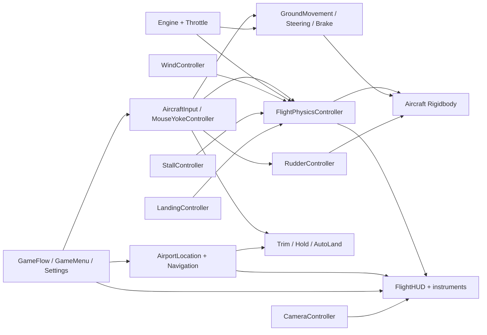
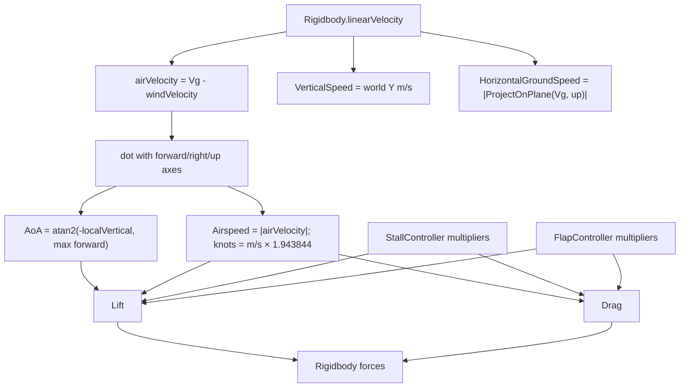
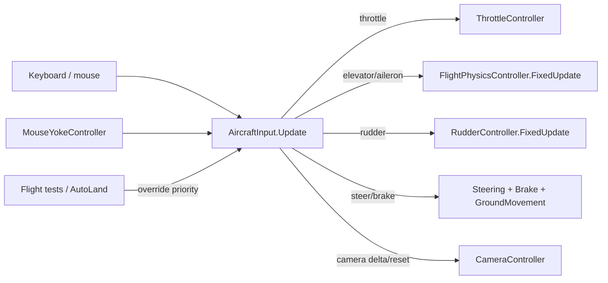
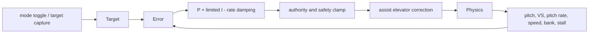
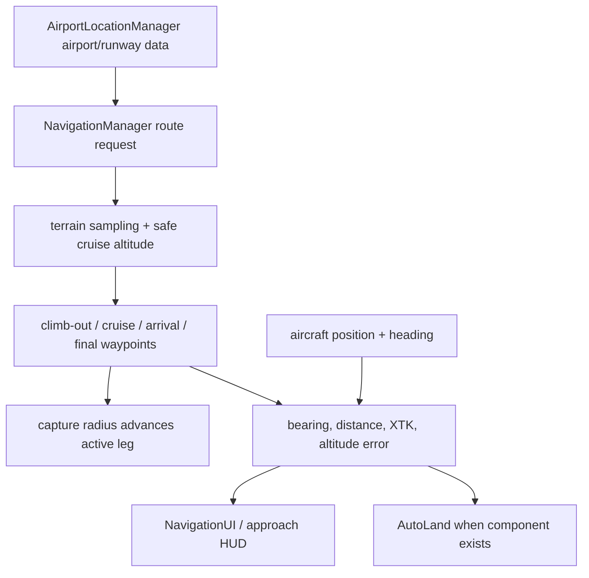

# Simply Fly — Technical Documentation

> Evidence baseline: current repository and serialized assets inspected on 2026-07-18. Runtime code is under `Assets/SimplyFly/Scripts`; the primary serialized implementation is `Assets/Scenes/Main.unity`. “Code default” means the C# initializer; “Main value” means the override serialized in `Main.unity`. Unconfirmed items are called out explicitly.

## 1. Project Architecture

### Scenes

| Scene | Build status | Purpose confirmed from assets |
|---|---:|---|
| `Assets/Scenes/Main.unity` | Enabled, build index 0 | Complete playable scene: aircraft, airports/runways, world, HUD, menus, flight school, navigation and weather-related managers. |
| `Assets/Scenes/Test.unity` | Not in build | Development/test scene. Its runtime role is unconfirmed; no production scene transition targets it. |
| `Assets/Scenes/WorldGenerationTest.unity` | Not in build | Editor/world-generation validation scene. |
| `Assets/Scenes/SampleScene.unity` | Disabled and absent from the inspected file inventory | Stale build-settings entry. |

`Main.unity` contains the aircraft directly; there is no project-owned aircraft prefab. `Assets/EmbersStorm - Free Piper M350 Plane/Prefabs/Piper M350.Blue.prefab` is an external visual asset, not the authoritative physics assembly.

### Runtime ownership



The `Aircraft` GameObject in `Main.unity` hosts the Rigidbody and most aircraft controllers. Cross-system communication is primarily direct serialized references and public properties/methods; there is no central event bus. Missing scene references are often repaired with `GetComponent`, `FindAnyObjectByType`, or runtime object creation. Airport changes and landing feedback use C# events.

### Initialization and frame order

Unity does not serialize an explicit Script Execution Order for these scripts. Therefore order between peer `Awake`, `Update`, and `FixedUpdate` methods is not guaranteed.

1. `Awake`: controllers cache the Rigidbody, repair legacy/zero tuning, and resolve local references.
2. `Start`: managers resolve scene-wide objects, load saved `PlayerPrefs`, configure windsocks/UI, and establish airport/navigation state.
3. `Update`: keyboard/mouse input, menus, settings, camera state, weather interpolation, navigation/UI, audio and assist mode toggles.
4. `FixedUpdate`: ground forces, aerodynamics, rudder/yaw, approach measurements, landing detection and other Rigidbody-facing work.
5. `LateUpdate`: camera follow and some visual/HUD work, preventing the camera from leading the aircraft transform.

Because several components add force/torque in independent `FixedUpdate` calls, their sum is deterministic for a tick, but intermediate diagnostic values and state transitions can observe peer state from either the current or previous tick.

## 2. Aircraft Physics

### Rigidbody and axes

The `Aircraft` Rigidbody in `Main.unity` is configured as follows:

| Property | Main value |
|---|---:|
| Mass | 1,200 kg |
| Linear damping | 0.02 |
| Angular damping | 3 |
| Center of mass | local `(0, -0.45, -0.2)` m |
| Inertia | automatic (`m_ImplicitTensor: 1`); serialized tensor `(1,1,1)` is not authoritative |
| Gravity | enabled |
| Interpolation | Interpolate |
| Collision detection | Continuous Dynamic |
| Constraints | bitmask 80; Unity-serialized axis meaning should be confirmed in Inspector before changing |

Aircraft-local forward is `Vector3.forward`; pitch torque uses local `(-1,0,0)`. The scene aircraft is yawed 90° in world space, so calculations correctly use its transform axes rather than fixed world X/Z assumptions.

### Air-data pipeline



`FlightPhysicsController.FixedUpdate` refreshes physical grounding and air data, updates its state machine, applies airborne thrust/aerodynamics/control moments and state constraints, then exposes diagnostic properties. Wind is an air-mass velocity, not merely a side force: relative air velocity is ground velocity minus `WindController.CurrentWindVelocity`. Heading comes from the horizontal projection of aircraft forward; bank and pitch come from transform orientation. Flight-path angle is derived from vertical versus horizontal velocity.

### Lift, drag and thrust

This is a tuned force model, not a blade-element or coefficient/wing-area simulation.

Conceptually:

```text
speedRatio = forwardAirflowSpeed / takeoffSpeed
baseLift = liftCurve(speedRatio) × weight × liftMultiplier
AoAFactor = a tuned level-lift term plus pitch/AoA influence
lift = clamp(baseLift × AoAFactor × flapLift × stallLift × landingLift, 0, maxLiftForce)
drag = tuned quadratic airspeed term × dragMultiplier × flapDrag × stallDrag
airborneThrust = engine/throttle command × airborneThrustMultiplier, applied forward
```

The exact implementation also adjusts a dynamic neutral AoA using throttle and vertical-speed stability, applies a tail force and pitch-rate damping, decomposes lift during bank, adds turn force, damps lateral slip quadratically, and applies a weather-vane yaw acceleration. Important Main overrides include lift curve keys `(0,0)`, `(0.45,0.04)`, `(0.7,0.25)`, `(0.9,0.68)`, `(1,0.86)`, `(1.25,1.12)`; `liftMultiplier=1.04`, `takeoffSpeed=30 m/s`, `maxLiftForce=16,500 N`, `pitchLiftInfluence=0.38`, `levelLiftFactor=0.68`, `referenceAngleOfAttack=8°`, `rotationSpeed=27 m/s`, `elevatorAuthority=2.2`, and `pitchResponse=2.4`.

`EngineController` owns running state and start/stop toggling. `ThrottleController` exposes the commanded 0–1 throttle. `GroundMovementController` separately supplies `idleThrust + throttle × maxGroundThrust` while grounded; `FlightPhysicsController` supplies airborne thrust, scaled by its `airborneThrustMultiplier` (legacy repair default 1.53). `PropellerController` is visual/RPM presentation and does not compute Rigidbody thrust.

### Pitch, roll and yaw

- Elevator: raw input is smoothed, combined with assisted trim/hold correction, multiplied by an airspeed authority curve, and converted to pitch acceleration/torque. Pitch-rate damping opposes local angular velocity. Ground rotation and airborne pitch limits add corrective moments.
- Aileron: smoothed input uses a roll-authority curve, `aileronAuthority`, and `rollResponse`; roll damping opposes roll rate. A bank-limit correction begins near the configured maximum bank (legacy repair default 70°).
- Rudder: `RudderController.FixedUpdate` smooths rudder input, scales authority by airspeed and stall state, adds yaw command, yaw-rate damping and yaw-limit torque. Slip is `atan2(local lateral air velocity, forward air velocity)`, normalized to `fullScaleSlipAngle=15°` for the slip ball.
- Passive yaw: `FlightPhysicsController` applies side-slip drag and weather-vane torque independently of the commanded rudder.

These controls are acceleration/force tunings rather than aerodynamic surface area and coefficient calculations. That makes them stable and easy to tune, but mass scaling and real-aircraft extrapolation are limited.

### Ground handling and wheels

`GroundMovementController.FixedUpdate` counts grounded `WheelCollider`s and uses fallback ray probes. Main values are idle thrust 650 N, maximum ground thrust 3,000 N, throttle response 0.4, maximum taxi speed 34 m/s, rolling resistance 70 N, idle creep target 2 m/s, breakaway thrust fraction 0.18, lateral grip 2.5 and ground hold 2,500 N. Its speed-limit curve maps throttle to fractions `(0,0)`, `(0.25,0.13)`, `(0.5,0.38)`, `(0.75,0.70)`, `(1,1)`; thrust fades from 90% of the selected limit. This is intentionally game-like speed governance.

`BrakeController` combines held brake and parking-brake state. `SteeringController` turns the nose wheel from steering input when the aircraft is grounded. `WheelVisualController` mirrors collider steering/spin into meshes. WheelCollider friction is deliberately reduced/reconfigured because custom ground forces own most longitudinal/lateral behaviour.

### State and phase behaviour

`FlightPhysicsController.AircraftState` progresses through ground roll, rotation and airborne states using physical ground probes, `rotationSpeed`, pitch, vertical speed and a liftoff confirmation timer. It does not auto-rotate: it only unlocks/labels rotation. Landing uses `LandingController` contact/height/vertical-speed logic, temporarily scales lift, and calls `EnterLandingRoll`; a touch-and-go can release the landing constraint near 90% of rotation speed.

Stall behaviour is owned by `StallController`: it derives warning/stall state from airspeed, AoA and airborne state, smooths severity, and publishes lift, drag and control-authority multipliers. `FlightPhysicsController` consumes those multipliers. Buffet/audio/HUD read the same state. The result is a progressive scripted stall, not separated-flow simulation.

Realistic elements include SI Rigidbody dynamics, gravity, relative wind, AoA, speed-squared resistance, banked lift, pitch/roll/yaw damping, crosswind decomposition and 3° glide geometry. Simplifications include capped forces, empirical curves, artificial stability, speed governors, state constraints, separate ground/air thrust models, automated trim/holds, and no fuel, density-altitude, propeller blade, engine thermodynamic or structural-load model.

## 3. Player Controls



`AircraftInput.Update` reads the new Input System keyboard/mouse directly. The `Assets/InputSystem_Actions.inputactions` asset is assigned in Project Settings but the aircraft controller does not consume generated `InputAction` callbacks; its actual bindings are code/serialized `Key` values. Main confirms engine `E`, brake `Space`, parking brake `J`, camera reset `R`, flaps extend `F`, flaps retract `V`. Axis keys and trim keys are defined in `AircraftInput.Update`; consult that method when rebinding because not all keys are serialized.

Input is cleared when game flow/menu state says flight controls are unavailable. Test overrides have priority over automation overrides; automation then replaces throttle, steering, rudder, elevator and brake inputs. Mouse yoke, when enabled, supplies normalized elevator/aileron with configurable sensitivity, dead zone, smoothing and maximum input. Manual input can disengage hold assists at a 0.25 threshold. Menus pause with `Time.timeScale`, and planner/menu states suppress flight control/camera capture.

## 4. Flight Assists

### Assisted trim

`AssistedTrimController` can capture the current elevator demand and slowly bias the neutral elevator. In Main it is disabled (`trimEnabled=0`). Limits are nose-up 0.38 and nose-down 0.32; capture requires at least 50 kt, bank below 30°, pitch rate below 8°/s and vertical speed below 8 m/s. Flap and airspeed terms adjust the recommendation.

### Pitch and vertical-speed hold



`FlightHoldAssistController.Update` handles mode input and target adjustment; its correction is consumed by flight physics. Pitch Hold captures current pitch and uses proportional plus limited integral correction with pitch-rate damping. Main: P 0.08, I 0.04, integral limit 0.32, maximum elevator 0.45, response 1.1, damping 0.018, target range −10° to +15°, minimum 50 kt, maximum bank 35°.

VS Hold captures/clamps vertical speed and adjusts in 100 ft/min steps. Main: P 0.18, I 0.06, integral limit 0.5, maximum elevator 0.65, response 1.35, damping 0.015, low-speed authority boost 1.45, target −3 to +3 m/s, minimum 52 kt, maximum bank 35°. Main explicitly allows VS Hold on ground and does not disengage it merely for low speed; this is game-like and potentially surprising. Both modes can disengage on manual elevator input and apply maximum safe VS/pitch guards.

### AutoLand

`AutoLandController` is present in code but no instance was confirmed in `Main.unity` by its script GUID. It therefore must be treated as unavailable in the shipped Main scene unless created at runtime by code not found in this checkout. When present, `U` engages only with a valid/unblocked approach, airborne aircraft and acceptable geometry. It progresses `Capture → Final → Flare → Touchdown → Rollout → Complete`, overrides `AircraftInput`, resets hold assists and parking brake, corrects centerline/heading with wind compensation, follows the selected glideslope, blends approach to touchdown speed, flares toward −0.05 m/s and 8.5° pitch, then closes throttle and brakes/steers during rollout.

## 5. Camera System

`CameraController` is a large multi-mode controller on the Main Camera. It supports chase, close chase, cockpit, left/right wing and cinematic views, orbit/quick-look, mode cycling, attached-anchor fallback creation, auto recenter, FOV transitions, smoothing and procedural motion cues. Main has no explicit cockpit/wing anchors, so fallback anchors are resolved/created relative to the aircraft.

The phase-one chase camera computes a focus point, required distance from bounds/framing padding, target yaw/pitch, look-ahead from speed and a screen offset. Position uses damped smoothing; rotation tracks the focus with limited roll influence. Main values include chase distance 14.5 m, height 2.2 m, minimum distance 16 m for framing, orbit sensitivity 0.18, pitch −10°..40°, default pitch 8°, recenter delay 0.65 s and speed 2.5, screen offset `(0,0.07)`. Close chase is 12.5 m and 1.5 m high. Attached view look limits are cockpit 75°×45° and wing 18°×12°.

Collision handling uses casts/layer masks where configured; the camera shortens its desired position rather than allowing world geometry between camera and target. Input activity cancels recenter; after the delay, yaw/pitch interpolate to defaults. Engine, runway, wind, landing, acceleration and turbulence cues are mixed per camera mode, with cockpit at full intensity and chase modes reduced.

## 6. Flight Planning and Navigation

`AirportLocationManager` owns serializable airport/runway records, active airport, runway direction/threshold/spawn points and aircraft repositioning. `AirportSelectorUI` and `GameMenuUI` expose selection. `AircraftResetController` zeroes Rigidbody motion and resets controller state after moving to a selected spawn.



Main navigation settings: normal capture 400 m, arrival 1,200 m, final 300 m; glideslope 3°; final approach 4,000 m; default cruise/pattern/climb-out/arrival altitudes 300/280/150/250 m; minimum terrain clearance 100 m. Route length chooses short/normal/long cruise targets 180/300/420 m, then samples terrain (40 samples), applies 140 m cruise terrain clearance and checks climb/descent feasibility with assumed gradients 7.5%/5.2%.

Approach validation samples a 3 km corridor, narrowing from 300 m to 80 m, with vertical allowances +60/−30 m, 20 m obstacle margin and 18 m minimum terrain clearance. Final glide targets a touchdown point 220 m beyond threshold and a 12 m threshold-crossing height. Bearing uses `atan2(x,z)`; heading error uses `Mathf.DeltaAngle`; cross-track error is the dot product against runway/leg right. Suggested VS is `clamp(-altitudeError / 45, -2.5, 2.5) m/s`, set to zero inside tolerance.

## 7. HUD and Instruments

`FlightHUDController` is the orchestration layer for legacy Canvas/TMP instruments. Main uses a 1920×1080 scale-with-screen Canvas. Some typed instrument references are null, while older `FlightHUDInstrument` objects are assigned; scripts use fallback resolution.

| Display | Source | Units/conversion |
|---|---|---|
| Airspeed | `FlightPhysicsController.AirspeedKnots` | relative-air m/s × 1.943844 |
| Altitude | aircraft world Y / airport-relative sources depending instrument | metres converted to feet where labeled (`×3.28084`) |
| Vertical speed | `FlightPhysicsController.VerticalSpeed` | m/s; VSI commonly displays ft/min (`×196.8504`) |
| Heading | `FlightPhysicsController.Heading` | degrees normalized 0–360 |
| Pitch/bank/attitude | physics transform-derived properties | degrees |
| Throttle/RPM | `ThrottleController`, `EngineController`, `PropellerController`/engine instrument | 0–100%, configured RPM presentation |
| Flaps | `FlapController` stage/normalized deployment | stage and degrees/percent depending view |
| Wind | `WindController` | direction-from degrees; knots; head/crosswind decomposition |
| Route/approach | `NavigationManager`, `ApproachGuidanceController`, `LandingController` | metres/km/nm and angular/lateral errors per widget |
| Slip/skid | `RudderController.SlipBallPosition` | normalized −1..1 |
| Warnings | stall, awareness, landing, brakes, hold, autoland | state text/color/audio |

UI refresh is frame-based in `Update`/`LateUpdate`; tapes smooth their displayed values independently. `NavigationUI` and menu screens are UI Toolkit documents built largely from C# rather than authored UXML assets. Main’s `GameMenuUI` `UIDocument.sourceAsset` is null by design because the script constructs the tree.

## 8. Weather, Wind, Audio, and World Systems

`WindController.Update` creates steady plus Perlin-like gust velocity from an aviation “from” heading. Main defaults: enabled, from 180°, 7 kt, gusts enabled, strength 2.5 kt, frequency 0.12, direction variation 8°. `HeadingToVector` converts heading to world direction; wind velocity points toward the reciprocal. Headwind/crosswind are projections against the active runway.

`WeatherManager` supports Clear and additional code-defined presets, interpolating sky/fog/sun, visibility, cloud/rain particle emission, wet surface material state and airport lights. It can create camera-local particle systems and a procedural rain loop at runtime. No `WeatherManager` instance was confirmed in Main; `GameSettingsManager.weather` is null. Weather settings can therefore persist without visible weather until a manager is added. `FlightPhysicsController` does guarantee a `WindController`, creating a `Wind System` if none exists.

`AircraftAudioController` layers engine idle/power, propeller, normal/strong/descent wind, runway rumble, stall warning/buffet, brakes, flaps and touchdown one-shots. Main reuses the same clip for idle/power/propeller, has no brake loop, tire chirp, engine start/stop or mixer groups, and reuses the firm touchdown clip for hard touchdown. Volumes/pitches are smoothed from throttle, speed, grounded state, stall severity, slip and landing events.

The world is scene-authored/generated terrain. `Assets/SimplyFly/Generated/World/WorldTerrainData.asset` is the generated terrain data. Editor-only generators under `Assets/SimplyFly/Editor/WorldGeneration` create terrain, biomes, water, roads, settlements, farms, vegetation, airports and landmarks; they do not stream terrain at runtime. There is no runtime world-loading/streaming system in the inspected code.

## 9. Game State and Scene Flow

`GameFlowController` owns menu/free-flight/flight-school/pause state inside the single Main scene. It coordinates `GameMenuUI`, `FlightLessonSystem`, `FlightSchoolUI`, HUD, reset and camera. There are no production scene loads for these modes. Main menu and planner are UI state overlays. Pause sets time scale and input availability. Free flight selects/spawns an airport, resets aircraft state and enables flight UI. Flight school starts a lesson definition and advances scripted instruction/check conditions. Reload/change airport uses the same reset/reposition path rather than loading a scene.

`GameSettingsManager` stores audio, HUD/awareness, camera, assists, navigation, approach helpers, weather and mouse-yoke values in `PlayerPrefs`, immediately applies them to resolved controllers, and can restore defaults. This is local per-player storage; there is no save-file versioning or cloud save.

## 10. Configuration Reference

Ranges below are engineering recommendations based on the implemented clamps/curves, not real-aircraft certification data.

| Component | Field | Current Main/default | Unit | Purpose | Increase / decrease | Recommended safe range |
|---|---|---:|---|---|---|---|
| Rigidbody | mass | 1200 | kg | Inertial weight | More sluggish / more responsive | 900–1,500 (retune forces outside) |
| Rigidbody | center of mass | `(0,-0.45,-0.2)` | m local | Stability/ground stance | Lower Y stabilizes / higher destabilizes | Y −0.7..−0.2 |
| FlightPhysics | `takeoffSpeed` | 30 | m/s | Lift-curve reference | Later lift / earlier lift | 25–35 |
| FlightPhysics | `rotationSpeed` | 27 | m/s | Rotation/state threshold | Later / earlier rotation | 24–32 |
| FlightPhysics | `maxLiftForce` | 16500 | N | Lift cap | More climb margin / less | 14,000–20,000 |
| FlightPhysics | `liftMultiplier` | 1.04 | ratio | Global lift | More lift / less lift | 0.85–1.2 |
| FlightPhysics | `levelLiftFactor` | 0.68 | ratio | Baseline lift at neutral AoA | Easier level flight / more sink | 0.5–0.85 |
| FlightPhysics | `referenceAngleOfAttack` | 8 | deg | AoA normalization | Softer AoA response / sharper | 6–12 |
| FlightPhysics | `elevatorAuthority` | 2.2 | tuned accel | Pitch control | Stronger / weaker | 1.5–3.0 |
| FlightPhysics | `pitchResponse` | 2.4 | 1/s | Elevator smoothing/response | Faster / slower | 1.5–4 |
| GroundMovement | `idleThrust` | 650 | N | Idle creep force | Faster creep / less creep | 300–900 |
| GroundMovement | `maxGroundThrust` | 3000 | N | Ground acceleration | Faster / slower takeoff roll | 2,000–4,500 |
| GroundMovement | `maximumTaxiSpeed` | 34 | m/s | Throttle speed governor | Higher cap / lower cap | 25–40 |
| GroundMovement | `rollingResistance` | 70 | N | Free-roll decay | Stops sooner / rolls longer | 40–150 |
| Hold Assist | `pitchHoldAssistStrength` | 0.08 | gain | Pitch P gain | Tighter/oscillatory / slower | 0.04–0.14 |
| Hold Assist | `pitchHoldIntegralStrength` | 0.04 | gain | Removes pitch bias | Faster wind-up / residual error | 0–0.08 |
| Hold Assist | `vsHoldAssistStrength` | 0.18 | gain | VS P gain | Tighter/oscillatory / slower | 0.08–0.28 |
| Hold Assist | `vsHoldMaxElevatorAuthority` | 0.65 | normalized | VS correction cap | More aggressive / less capable | 0.35–0.7 |
| Navigation | `glideSlopeDegrees` | 3 | deg | Final vertical path | Steeper / shallower | 2.5–3.5 |
| Navigation | `finalApproachDistance` | 4000 | m | Final leg length | Longer stabilization / shorter | 3,000–6,000 |
| Camera | `chaseDistance` | 14.5 | m | Chase spacing | Smaller aircraft / larger | 10–25 |
| Camera | `positionSmoothing` | 0.28 | s-like damp | Positional lag | Smoother/slower / tighter | 0.08–0.5 |
| Camera | `recenterDelay` | 0.65 | s | Idle time before recenter | Later / earlier | 0.3–2.5 |
| Wind | `windSpeedKnots` | 7 | kt | Steady wind | More drift / less | 0–20 for normal play |
| Wind | `gustStrengthKnots` | 2.5 | kt | Gust amplitude | More turbulence / less | 0–6 |
| HUD | `safeApproachSpeedMin/Max` | 65/75 | kt | Approach cue band | Shifts allowed band | Keep min < max; 55–90 |

The complete serialized field list is best inspected in the named component because many curves and presentation-only values are too numerous to tune safely from a flattened table.

## 11. Code Flow Examples

1. **Engine start:** `AircraftInput.Update` detects `E` → `EngineController` toggles running → audio starts/fades layers → ground/air thrust paths now accept throttle.
2. **Throttle:** keyboard command updates `AircraftInput.ThrottleInput` → `ThrottleController` clamps/exposes 0–1 → ground controller smooths it and applies governed thrust while grounded; flight physics applies scaled forward thrust airborne → propeller/audio/HUD read the same command/state.
3. **Taxi:** idle/full thrust competes with rolling resistance, brake and speed fade → steering rotates nose wheel and adds yaw influence → custom lateral grip suppresses skid.
4. **Takeoff:** throttle accelerates Rigidbody → airspeed feeds lift curve and control authority → pilot elevator raises nose → state becomes Rotating → wheel probes clear for confirmation time with positive VS → Airborne; ground controller transitions out.
5. **Pitch input:** key/mouse yoke → input elevator → manual-disengage check for holds → trim/assist bias → smoothed elevator → authority curve and pitch moment → pitch damping/limits → Rigidbody torque.
6. **Bank/turn:** aileron creates roll moment → lift vector gains side component → turn-force/yaw-assist and rudder/weather-vane effects coordinate turn → roll damping and bank cap stabilize it.
7. **Stall:** low speed/high AoA increases `StallController` severity → lift and control multipliers fall, drag rises → warning/buffet/HUD activate → nose/vertical motion follows remaining forces and scripted stability.
8. **VS Hold:** mode captures current VS → each frame computes limited PI plus pitch-rate damping → safety and manual-input gates apply → correction is added to elevator path in physics.
9. **Approach/landing:** navigation selects runway and final waypoint → glideslope/centerline/heading errors update → HUD guides pilot (or optional AutoLand overrides controls if actually instantiated) → landing probes detect touchdown → feedback/audio fire, lift is reduced and landing-roll constraints/braking take over.
10. **Camera orbit/recenter:** mouse delta enters camera state → desired yaw/pitch and collision-adjusted position update → smoothing follows target → after no input for recenter delay, yaw/pitch return to configured defaults.

## 12. Dependencies and Known Limitations

### Required packages/assets

- Unity 6 / URP 17.5.0 (`com.unity.render-pipelines.universal`).
- Input System 1.19.0, uGUI 2.5.0, AI Navigation 2.0.13, Timeline 1.8.12, Test Framework 1.7.0 and built-in physics/terrain/audio/UI modules.
- TextMesh Pro assets and the third-party `EmbersStorm - Free Piper M350 Plane` visual package.
- Project audio clips referenced by GUID from Main; several logical layers intentionally share clips.

### Confirmed issues and debt

- No project-owned aircraft prefab; the authoritative aircraft assembly is embedded in `Main.unity`, making reuse and diff review fragile.
- `AutoLandController` exists but was not confirmed as a Main component. Its HUD reference is also null.
- `WeatherManager` is not confirmed in Main; settings and weather UI may have no visual target.
- Numerous Main references are null and rely on scene-wide searches/runtime creation (`WindController`, camera anchors, mouse yoke, several HUD widgets). This is functional but order-sensitive and masks wiring mistakes.
- `InputSystem_Actions.inputactions` is not the aircraft’s binding source; controls are largely hard-coded `Keyboard.current`/`Mouse.current` checks, limiting rebinding and device support.
- Ground and airborne thrust are separate tuned models, so transition continuity depends on multipliers and state timing.
- Multiple components write to one Rigidbody without explicit script execution order.
- Physics uses empirical curves/caps and assumes constant atmosphere; no density, fuel, damage, load-factor, true propeller, engine temperature or compressibility model.
- World generation is editor-only; no runtime terrain streaming.
- UI mixes legacy Canvas/TMP, UI Toolkit built in code, and fallback component discovery.
- `Main.unity` has a stale disabled `SampleScene` build entry.
- Several audio references/mixer groups are missing; engine start/stop, tire chirp and brake layers cannot play dedicated assets.
- External TMP examples are not project-owned runtime code and are excluded from `Script_Reference.md`.

### Could not be confirmed statically

Play-mode behaviour, actual collider contacts on every runway, all generated terrain clearance results, and the effective meaning of Rigidbody constraint bitmask 80 should be verified in the Unity Inspector/play mode. No gameplay code was modified while producing this documentation.
